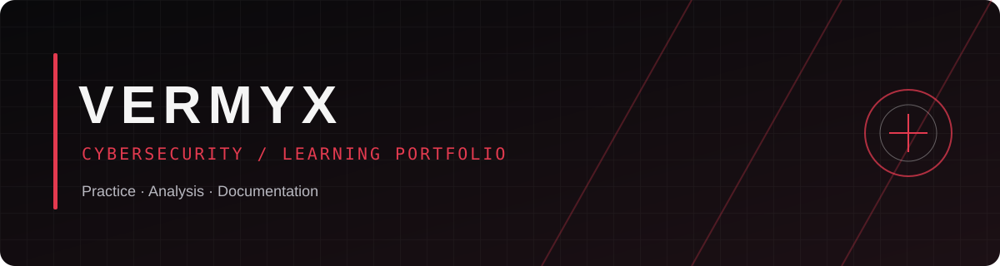

# VERMYX · Cybersecurity Portfolio

**Uczę się przez praktykę. Weryfikuję wyniki. Dokumentuję wnioski.**  
**Learn through practice. Verify results. Document the findings.**

Linux · Networking · Security Labs · OSINT · Web Security

---

## Wybierz język / Choose a language

- 🇵🇱 **[Polskie portfolio](pl/README.md)** — droga edukacyjna, statystyki TryHackMe, obszary rozwoju i plan nauki.
- 🇬🇧 **[English portfolio](en/README.md)** — learning profile, TryHackMe stats, areas of focus and roadmap.

## Szybki dostęp / Quick links

| Materiał / Resource | Polski | English |
|---|---|---|
| Pokoje / Completed rooms | [Katalog pokojów](pl/progress/ROOMS.md) | [Room catalogue](en/progress/ROOMS.md) |
| Roadmapa / Learning roadmap | [Plan rozwoju](pl/ROADMAP.md) | [Learning roadmap](en/ROADMAP.md) |
| Notatki / Lab notes | [Szablon notatek](pl/templates/LAB_NOTE_TEMPLATE.md) · [Przykładowa notatka FTP](pl/notes/ftp-service-enumeration.md) | [Lab note template](en/templates/LAB_NOTE_TEMPLATE.md) |
| Profil GitHub / GitHub profile | [README PL](github-profile/README_PL.md) | [README EN](github-profile/README.md) |
| Bio GitHub | [Bio do skopiowania](github-profile/BIO.md) | |

## O portfolio / About this portfolio

This repository documents my learning in cybersecurity through authorized labs, Linux practice, network enumeration, security analysis and OSINT study. It is an educational portfolio, not a claim of commercial penetration-testing experience.

To repozytorium dokumentuje naukę cyberbezpieczeństwa poprzez autoryzowane laboratoria, pracę z Linuksem, rozpoznanie sieci, analizę bezpieczeństwa i OSINT. Jest to portfolio edukacyjne, a nie deklaracja komercyjnego doświadczenia w testach penetracyjnych.

## Zasady / Principles

- Pracuję wyłącznie we własnych środowiskach, autoryzowanych laboratoriach lub systemach, do których mam zgodę.
- Nie publikuję flag, haseł, tokenów, kluczy prywatnych ani konfiguracji VPN.
- Oddzielam obserwacje od hipotez, opisuję ograniczenia i weryfikuję wnioski.
- Ukończenie pokoju nie oznacza automatycznie pełnego opanowania tematu.

> TryHackMe stats are a snapshot supplied on 27 October 2026 and may change. / Statystyki TryHackMe to migawka z 27 października 2026 r. i mogą się zmieniać.
